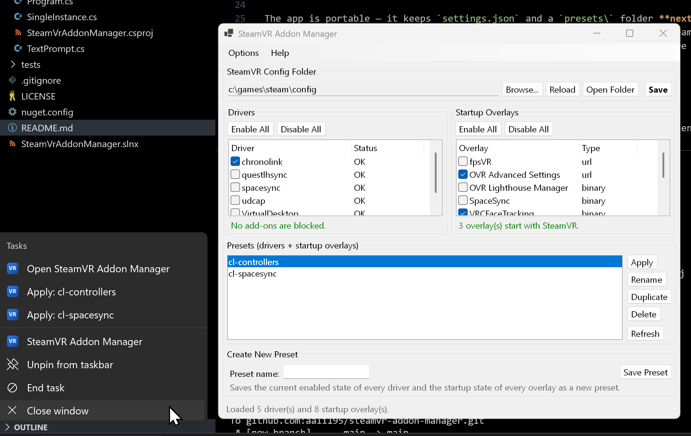

# SteamVR Addon Manager

A lightweight Windows tool for managing SteamVR **drivers** and **startup overlays** by editing
SteamVR's config files (before SteamVR is run). Portable, single-file exe, no install.

NOTE: Written with the help of an LLM



## Requirements

- Windows 10/11
- Pick one of the two builds from the releases:
  - **Small** (`SteamVrAddonManager.exe`, ~400 KB) — needs the
    [.NET 8 Desktop Runtime](https://dotnet.microsoft.com/download/dotnet/8.0) (x64).
  - **Self-contained** (`SteamVrAddonManager-standalone.exe`, ~70 MB) — bundles the runtime, nothing to install.

## Usage

- **Drivers** — enable/disable drivers and unblock safe-mode-blocked add-ons.
- **Startup Overlays** — choose which dashboard overlays start with SteamVR.
- **Presets** — save the current driver + overlay state and re-apply it later. Presets live in
  `presets\` next to the exe.
- **Options → Show presets in the taskbar menu** adds the presets to the pinned app's right-click
  Jump List (pin the app to the taskbar first).

The app is portable — it keeps `settings.json` and a `presets\` folder **next to the exe** (both are
created on first run; the build/publish output already ships them). The Steam config folder is
auto-detected; use **Browse…** to point at a different one. Config files are backed up (`.bak`) and
written atomically.

### Command line

```
SteamVrAddonManager.exe --apply "<preset>"   # apply a preset, headless/silent
      [--config "<Steam>\config"]            # override the config folder
      [--log "<file>"]                       # append a result/warning line
```

Exit codes: `0` success · `1` bad args · `2` preset not found · `3` config folder not found ·
`4` apply/write error.

## Build

```
dotnet build -c Debug
```

Publish produces one of two single-file exes:

```
# Small framework-dependent exe (~400 KB) - requires the .NET 8 Desktop Runtime
# https://dotnet.microsoft.com/download/dotnet/8.0
dotnet publish -c Release -r win-x64

# Self-contained exe (~70 MB) - bundles the runtime, no install needed
dotnet publish -c Release -r win-x64 -p:BundleRuntime=true
```

Both land in `src\SteamVrAddonManager\bin\Release\net8.0-windows\win-x64\publish\`.

## License

MIT — see [LICENSE](LICENSE).
